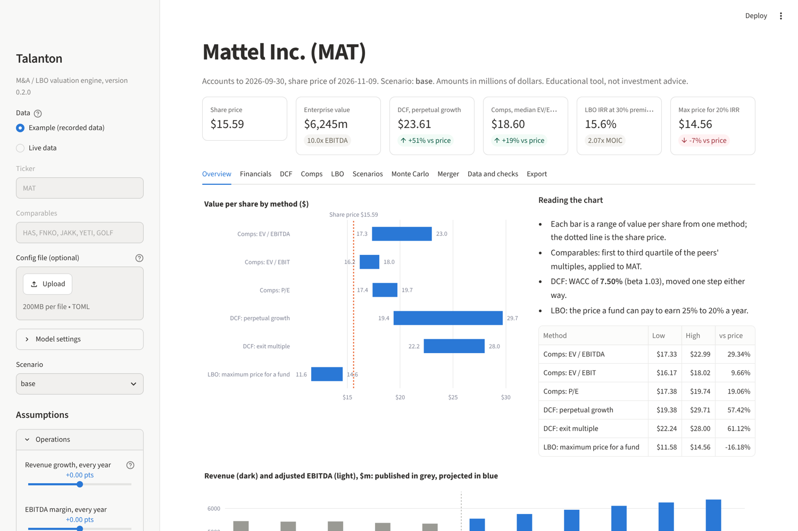
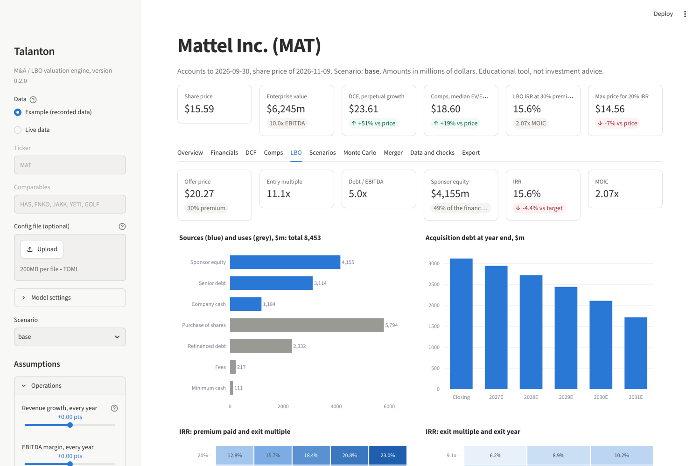

# Talanton
fazdazdazs
From a ticker to an M&A / LBO valuation model in Excel, with live formulas, and an interactive app to play with it.

Talanton fetches the published accounts of a listed company, puts them in bank format, projects its three financial statements, values it by DCF and trading comparables, simulates its buyout by a fund (LBO), then writes everything into an Excel workbook where every figure is a formula: change one assumption and the model recalculates.

The name comes from the Greek τάλαντον: the talent, both a unit of weight and a unit of money. To value is to weigh.

> Version 0.2. Educational project: nothing Talanton produces is investment advice.



## What you get

Example shipped with the repository: Mattel (MAT), accounts to 30 September 2026, share price of 9 November 2026.

```
MATTEL INC /DE/ (MAT), share price $15.59, enterprise value $6,245m
  DCF, perpetual growth : $ 23.61 per share (WACC 7.50%, beta 1.03)
  DCF, exit multiple    : $ 25.06 per share
  Comps, median EV/EBITDA: $ 18.60 per share
  LBO at a 30% premium: IRR 15.6%, MOIC 2.07x
  Maximum price for a fund targeting a 20% IRR: $14.56 per share

  Scenario        DCF growth   DCF multiple   LBO IRR   Max price
  base                23.61          25.06     15.6%       14.56
  bull                28.00          29.29     21.1%       22.20
  bear                19.57          21.15      9.7%        9.75
  mezzanine           23.61          25.06     16.1%       15.87

Reconciliation: 922 formulas recalculated without error, Excel = Python on 23 key figures.
```

These values follow from mechanical default assumptions. They are a starting point: the analyst's work begins on the Assumptions sheet.

The workbook (`examples/output/MAT_model.xlsx`) has nine sheets:

| Sheet | Content |
|---|---|
| Summary | Value per share by method (football field), LBO outcome, checks, data sources |
| Assumptions | Every editable cell, in blue on a coloured fill, with the reason for each proposed value |
| Historical | Five restated fiscal years and the last twelve months, with the SEC tag behind each line |
| Projections | Income statement, cash flows and balance sheet over six to ten fiscal years |
| DCF | Free cash flows, two terminal values, bridge to value per share |
| Comps | Peer multiples, statistics, sector reference, implied value of the target |
| LBO | Price, sources and uses, two-tranche debt schedule, IRR, maximum price for a target IRR |
| Sensitivities | Four cross tables, in formulas |
| Checks | Consistency of the model, points of judgment, reconciliation with the Python engine |

Colour conventions: blue for a hard-coded figure, black for a formula, green for a link to another sheet.

## Installation

Python 3.11 or later. On macOS or Linux:

```zsh
python3 -m venv .venv
source .venv/bin/activate
pip install -e ".[market,app,dev]"
```

On Windows (PowerShell): `py -m venv .venv`, then `.\.venv\Scripts\Activate.ps1`, then the same `pip` command.

LibreOffice (free) is optional: when installed, Talanton uses it to recalculate the workbook and check that Excel and Python agree. Without it, Excel computes everything on opening and the Checks sheet does the same comparison.

## Usage

Replay the example, with no network, from the data recorded in the repository:

```zsh
talanton run MAT --peers HAS,FNKO,JAKK,YETI,GOLF \
    --cache examples/cache --offline \
    --adjustments examples/adjustments/MAT.toml --config examples/configs/MAT.toml
```

Open the interactive app (the example is selected by default):

```zsh
talanton app
```

On another company, online. The SEC asks callers to identify themselves (name and e-mail): copy `.env.example` to `.env` and fill in `TALANTON_CONTACT`.

```zsh
talanton peers GIS                                  # suggest comparables from the SEC industry code
talanton run GIS --peers CPB,CAG,SJM,KHC,HRL
```

Other commands:

| Command | What it does |
|---|---|
| `talanton merger HAS MAT --stock 0.5 --synergies 150` | Accretion / dilution of an acquirer's earnings per share |
| `talanton sources` | Lists the data sources and which API keys are set |
| `talanton industries [--refresh]` | Sector betas and multiples (Damodaran); `--refresh` downloads the current tables |
| `talanton run ... --scenario bull` | Builds the workbook of one scenario of the config |

## The interactive app

`talanton app` opens a page in the browser. Sliders in the sidebar feed the same engine as the command line, so every chart and figure updates at once.

- **Overview**: football field against the share price, revenue and EBITDA.
- **Financials, DCF, Comps, LBO**: tables, value bridge, sensitivity heatmaps, sources and uses, debt paydown.
- **Scenarios**: base, bull, bear (or yours) side by side, plus your live changes.
- **Monte Carlo**: a distribution of DCF values instead of a single figure.
- **Merger**: accretion or dilution for an acquirer chosen among the comparables.
- **Data and checks**: where each input comes from, API keys, warnings, the reason for every assumption.
- **Export**: the Excel model with the assumptions you set, and your changes as a config file.



## Data sources

Two editions share one code base, through interchangeable providers.

**Open edition** (free):

| Source | Used for | Key |
|---|---|---|
| SEC EDGAR | Accounts, company profile, industry code, peer suggestions | None (identification only) |
| FRED | Risk-free rate (10-year Treasury), SOFR, credit spreads, breakeven inflation | None (public CSV), or a free API key |
| Damodaran (NYU Stern) | Sector betas and EV multiples; a January 2026 snapshot is bundled | None |
| Yahoo Finance | Share prices, monthly history for the beta | None (`yfinance`) |
| Alpha Vantage, Finnhub | Backup prices; Finnhub also suggests peers | Free key |

Prices come from a chain of providers tried in order, and everything is cached locally. The Summary sheet and the app state which source served each input.

**Terminal edition** (experimental): with `TALANTON_BLOOMBERG=1` on a computer running a logged-in Bloomberg Terminal, prices and history are asked from Bloomberg first (`pip install blpapi`). With `bloomberg_formulas = true` in the config, share prices in the workbook become live `BDP` formulas that fall back on the recorded value without a Terminal. Bloomberg data is licensed: never commit it (the cache folder is git-ignored), and check your institution's rules on automated use.

API keys live in a `.env` file that is never committed (see `.env.example`).

## Customising a run

Judgment is not in the code. It lives in two text files, versioned with your work.

`adjustments/MAT.toml` corrects or completes published accounts, each line with its source:

```toml
[ebitda]
source = "Q3 2026 earnings release: $88m of tariff refunds"
"LTM" = -88.0
```

A config file customises the model:

```toml
acquisition_premium = 0.35                       # assumption overrides: a number,
ebitda_margin = [0.115, 0.12, 0.125, 0.13, 0.13, 0.13]   # or one value per projected year

[settings]
years = 8                  # 6 to 10 projected years; the LBO holding period is years - 1
beta_method = "sector"     # auto | regression | sector
industry = "Recreation"    # Damodaran industry, when the SEC code maps to none
include_leases = true      # add operating lease liabilities to net debt
theme = "midnight"         # classic | midnight | forest | slate
bloomberg_formulas = false

[theme]                    # any colour of the theme, in hex
ink = "0B3D2E"

[scenarios.bull]           # absolute values, or moves relative to the base case
revenue_growth = { shift = 0.01 }
senior_leverage = { scale = 1.1 }
```

## How it is built

```
talanton/
├── data/           SEC EDGAR, FRED, Damodaran, price providers, Bloomberg, peer suggestions
├── restatement/    raw facts -> bank-format statements, LTM, analyst adjustments
├── model/          default assumptions, settings, config and scenarios, projection
├── valuation/      DCF, comparables, LBO, sensitivities, Monte Carlo, merger
├── excel/          workbook, formulas and themes
├── checks/         verifications and Python / Excel reconciliation
├── app/            interactive interface (Streamlit + Plotly)
├── engine.py       assembly, in pure Python
└── cli.py          command line
tests/              76 tests, no network
examples/           recorded data, Mattel adjustments and config, workbook produced
```

The reliability principle: the model exists twice. The Python engine computes every figure without Excel; the workbook recomputes them with its formulas. The tests require both to agree to 0.0001%, including after changing about thirty assumptions, with eight projected years, and with options in the money.

```zsh
pytest
```

## Methods, in short

- **Last twelve months (LTM)**: last fiscal year + current year to date - same period one year earlier.
- **Adjusted EBITDA**: operating income + D&A + asset impairments + analyst adjustments.
- **Projections**: year one starts from the pace and margin of the last twelve months, then converges to 2% growth and the three-year average margin.
- **Cost of capital**: CAPM. Risk-free rate from FRED. Beta from a regression with Blume's adjustment, or, when its R² is below 0.15, the sector's unlevered beta re-levered at the company's own debt/equity.
- **DCF**: free cash flows discounted at the WACC, mid-year convention, first year prorated, terminal value by perpetual growth and by exit multiple.
- **Comparables**: EV/Revenue, EV/EBITDA, EV/EBIT, P/E on LTM figures; negative multiples and those above 40x are excluded.
- **Dilution**: treasury stock method for options, at the share price for the DCF and at the offer price in the LBO.
- **LBO**: buyout at a premium at the end of the current fiscal year; a senior tranche (SOFR + single-B spread by default) repaid by amortisation and cash sweep, an optional subordinated tranche with cash and PIK interest; sale at the end of the plan at the entry multiple. The maximum price for a target IRR comes from an exact formula.
- **Monte Carlo**: independent normal shocks on growth, margin, WACC and perpetual growth; the standard deviations are your inputs.
- **Merger**: pro forma EPS on LTM earnings, with stock and debt financing and pre-tax synergies.

## Known limits of version 0.2

- Companies filing with the SEC under US GAAP only (no European companies yet). Banks, insurers and real-estate companies are not covered.
- Peer suggestions come from coarse SEC industry codes and include micro-caps; there are no precedent transactions.
- The merger model has no purchase price allocation, and exists in the app and the command line, not in the workbook.
- LBO fees are expensed, there is no management package, and options are valued at one average strike.
- Not verified from this development environment, which has no direct internet access:
  - the online download code runs only against a simulated network in the tests; the example data was read from the same sources (SEC, FRED, Yahoo, Damodaran) through a browser;
  - the Alpha Vantage, Finnhub and Bloomberg providers were written from their documentation and never run against the real services;
  - the workbook was recalculated and read back with LibreOffice, not with Microsoft Excel.

## Credits and disclaimer

Sector data: Aswath Damodaran, NYU Stern (https://pages.stern.nyu.edu/~adamodar/). Rates: Federal Reserve Bank of St. Louis (FRED). Accounts: US Securities and Exchange Commission (EDGAR). Free market data is meant for personal use and carries no quality guarantee.

Educational project. Nothing produced by Talanton is investment advice, a forecast or a recommendation.
